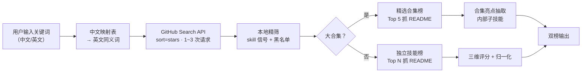

<div align="center">

# 🛰️ where-find-good-skills（WFGoodSkills）

**在 GitHub 上按关键词搜罗优质 Agent skill 仓库，一键三维排行**

按「星标数 × 更新频率 × README 内容容量」加权打分，独立技能与大合集分榜对比，
支持 **年内热门榜**，让每次搜索都能发现真正有用的新东西。


*一次搜索，三个视角：老牌精品 · 新兴热门 · 大合集导航*

</div>

---

## ✨ 特性

| | 能力 | 说明 |
|---|---|---|
| 🏆 | **三维加权排行** | 星标（log 归一化）0.5 + 更新活跃度 0.3 + README 容量 0.2，杜绝"一星独大" |
| 🔀 | **两榜分流** | 大合集（awesome/collection/library…）单独成榜，不再长期霸占独立技能曝光 |
| 🧭 | **合集内部亮点** | 合集榜每行附带从 README 抽取的子技能亮点，好技能一个不落 |
| 🚀 | **年内热门榜** | `--sort rising`：一年内创建 + 两周内有更新，专看新兴黑马 |
| 🇨🇳 | **中文关键词** | 内置 20+ 类中→英映射，直接说"数据可视化"就能搜 |
| ⚡ | **极低消耗** | 典型任务仅 3 次搜索请求（免登录配额内）+ 25 次 raw README（零配额） |
| 🛡️ | **健壮容错** | 限流自动退避、三级召回降级、无效仓库自动剔除 |

---

## 🚀 快速开始

**方式一：对话触发（推荐）**

把技能文件夹安装到你的 AI 助手的 skills 目录后，直接说：

```
用 WFGoodSkills 搜一下「数据可视化」相关的 skill
看看「视频剪辑」有没有新兴热门技能
```

**方式二：命令行**

```bash
git clone https://github.com/leoleisysu-spec/where-find-good-skills.git
cd where-find-good-skills

python3 scripts/search_skills.py "数据可视化"              # 综合榜 Top 20
python3 scripts/search_skills.py "数据可视化" --sort rising # 年内热门榜
python3 scripts/search_skills.py excel --top 10 --json 结果.json
```

> 💡 安装到 Claude Code：复制 `where-find-good-skills/` 到 `~/.claude/skills/`；
> 安装到 Codex：复制到 `~/.codex/skills/`。

---

## 📸 效果预览（真实检索，关键词"数据可视化"）

```
召回 143 → 独立技能候选 128 → 合集候选 14 · 独立榜展示 8（README 8/8） · 合集展示 3（README 3/3） · 搜索请求 3 次
```

### 🟢 独立技能综合榜

| # | 仓库 | 简介 | ★ | 更新 | 容量 | 分 |
|---|---|---|---|---|---|---|
| 1 | [tradermonty/claude-trading-skills](https://github.com/tradermonty/claude-trading-skills) | Claude Code skills for equity investors and traders — market… | 3,243 | 3天前 | 47.1KB | 0.815 |
| 2 | [larashero3-dotcom/lieflat-charts](https://github.com/larashero3-dotcom/lieflat-charts) | Data visualization Skill for AI Agents, turning data into po… | 6,404 | 9天前 | 11.9KB | 0.756 |
| 3 | [op7418/guizang-ppt-skill](https://github.com/op7418/guizang-ppt-skill) | AI-agent Skill for generating polished HTML slide decks… | 28,556 | 78天前 | 14.7KB | 0.785 |

### 🟡 精选合集榜（大合集单列对比，避免霸榜）

| # | 仓库 | 简介 | ★ | 更新 | 容量 | 分 | 内部亮点 |
|---|---|---|---|---|---|---|---|
| 1 | [alvinreal/awesome-openclaw](https://github.com/alvinreal/awesome-openclaw) | A curated list of the best OpenClaw resources… | 744 | 8天前 | 54.1KB | 1.000 | 亮点: openclaw/openclaw、openclaw.ai · 含 ~99 个子技能条目 |

---

## ⚙️ 参数速查

| 参数 | 必填 | 说明 |
|---|---|---|
| `keyword` | ✅ | 分类/功能关键词，中英文均可 |
| `--top` | 可选 | 独立榜展示条数，默认 20，上限 50 |
| `--sort` | 可选 | `combo` 综合（默认）｜`stars` 星标｜`active` 活跃｜`detail` 容量｜`rising` 年内热门 |
| `--json` | 可选 | 额外输出结构化 JSON 到指定路径 |

---

## 🧮 评分模型

```
综合分 = 0.5 × 星标归一化(log₁₀(★+1))
       + 0.3 × 活跃度(e^(−距今天数/180))
       + 0.2 × 容量归一化(log₁₀(README字符数+1))
```

> 星标是长尾分布，取对数压缩；活跃度按 180 天半衰衰减；README 容量反映内容充实度。
> 综合分 ≠ 星标排名：星标高但长期不更新、README 单薄的仓库会被合理拉低。

---

## 🔄 工作流程



---

## 🗺️ 内置中文关键词映射（可扩展）

`PPT / 演示 → presentation, slides, deck` ｜ `数据可视化 / 图表 → data visualization, chart, dashboard` ｜
`Excel / 表格 → excel, spreadsheet` ｜ `文档 / Word → document, docx, writing` ｜ `绘图 / 图片 → diagram, drawing, design` ｜
`视频 → video, editing, movie` ｜ `音频 → audio, podcast, voice` ｜ `爬虫 → scraper, crawl` ｜ `翻译 → translation` ｜
`写作 → writing, copywriting` ｜ `代码 → coding, programming` ｜ `数据分析 → data analysis, analytics` ｜
`营销 → marketing, seo` ｜ `邮件 → email` ｜ `日历 → calendar` ｜ `搜索 → research` ｜ `测试 → testing` ｜
`部署 → devops, deploy` ｜ `安全 → security, pentest`

> 编辑 `scripts/search_skills.py` 中的 `KEYWORD_MAP` 即可新增分类。

---

## 🤔 常见问题

**Q：为什么独立榜里没有看到 awesome 大合集？**
A：名字/描述含 awesome、collection、library 等合集特征的仓库会被自动分流到"精选合集榜"，避免大合集凭借高星标长期霸榜、挤压独立技能曝光。

**Q：搜索命中不足怎么办？**
A：脚本自动降级——标准模板 → topic 锚定模板 → 兜底模板，最多 6 次请求；仍无结果会提示换关键词。

**Q：遇到限流（403）？**
A：免登录配额 10 次搜索/分钟，脚本自动退避等待（最长 60s）；连续两次失败请等待约 1 分钟。

---

## 📄 License

[MIT](LICENSE) © 2026 [leoleisysu-spec](https://github.com/leoleisysu-spec)

**讲课、分享、二次开发均免费，保留版权声明即可。**
